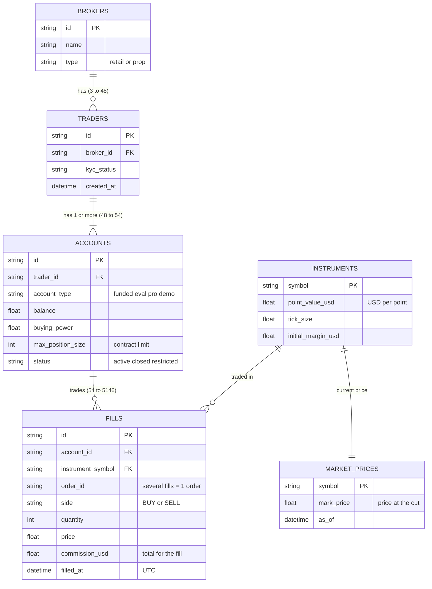

# Table relationships

Main chain: **Broker → Trader → Account → Fill**. `instruments` and `market_prices` are reference tables that give each fill its value.

## Tables

| Table | Rows | What it is |
| --- | --- | --- |
| `brokers` | 3 | The firms (prop firms and one retail broker) that provide the accounts. |
| `traders` | 48 | The people. 5 traders have more than one account. |
| `accounts` | 54 | Funded accounts with their rules (`max_position_size`), type and status. |
| `fills` | 5,146 | Every executed buy or sell. The only table that moves over time. |
| `instruments` | 8 | Contract specs. `point_value_usd` = dollars per point (ES is 10× MES). |
| `market_prices` | 8 | Price of each product at the cut; used to value open positions. |

## What the diagram does not show

- `fills` has no `trader_id`: to know whose fill it is, go through the account (fill → account → trader).
- `order_id` points to no table; it only groups fills that belong to the same order.
- The session (trading day) is not a table: it is derived from `filled_at` in `load.py` (17:00 to 16:00 Chicago time).
